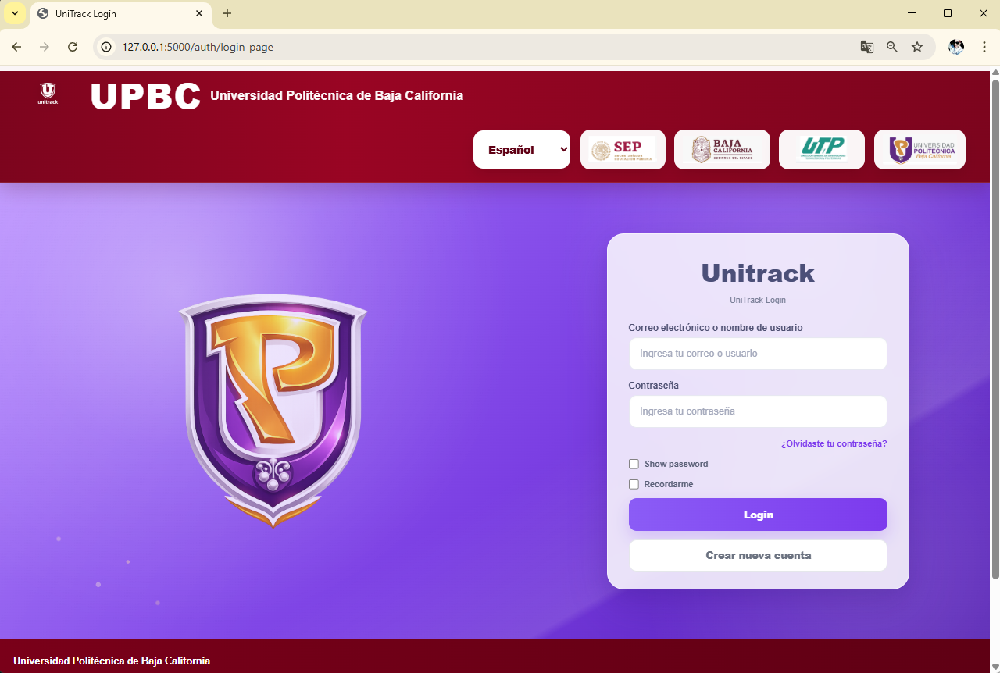
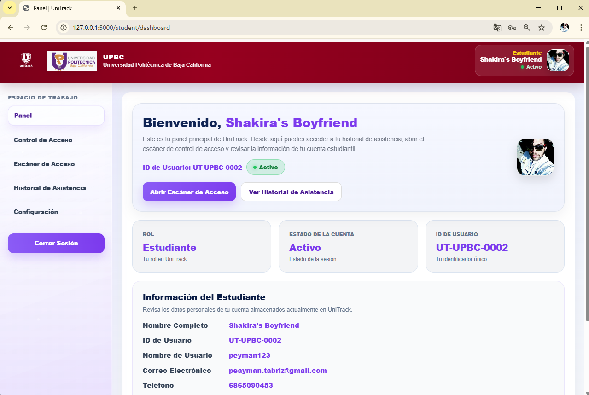
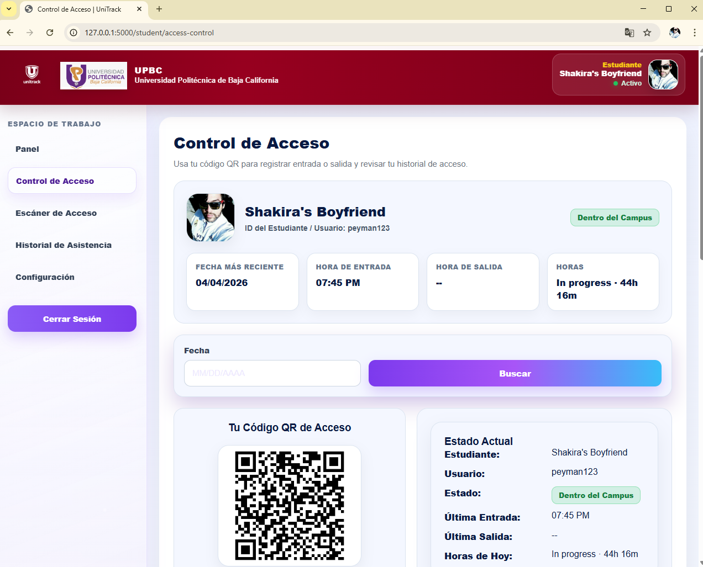
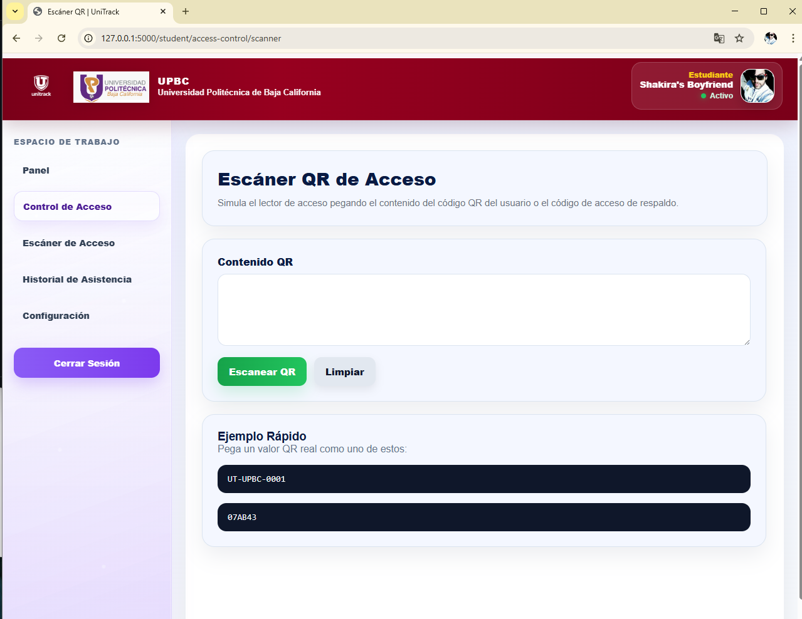
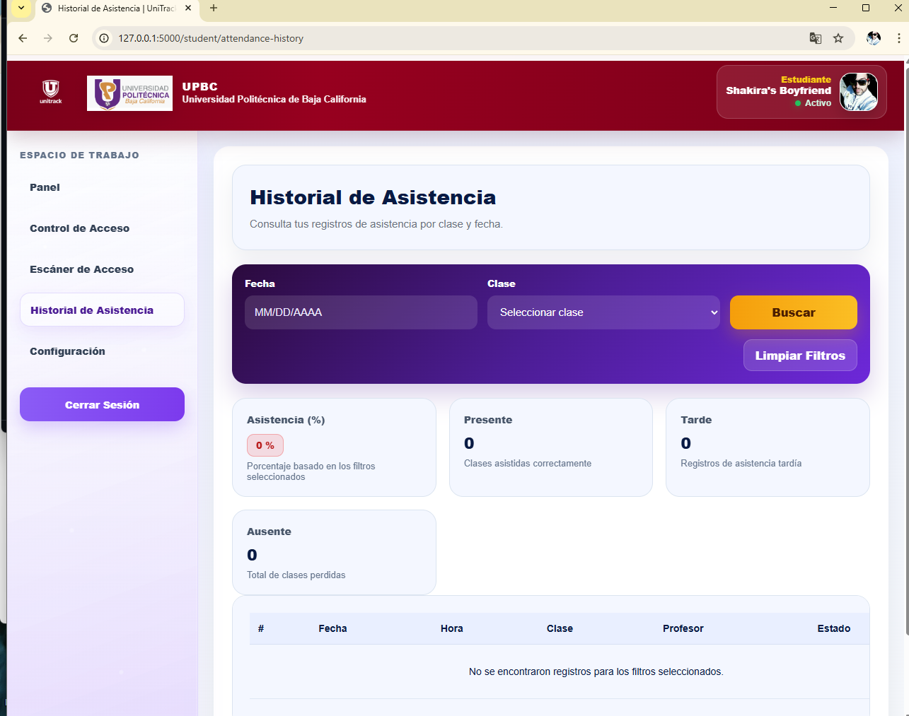
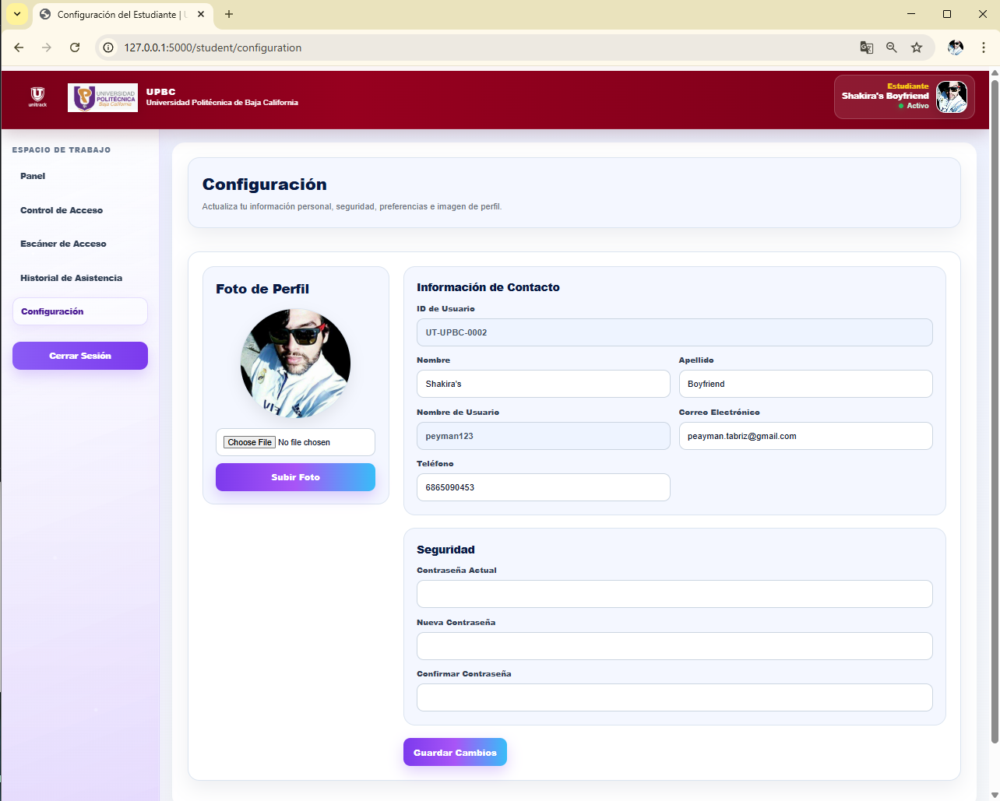
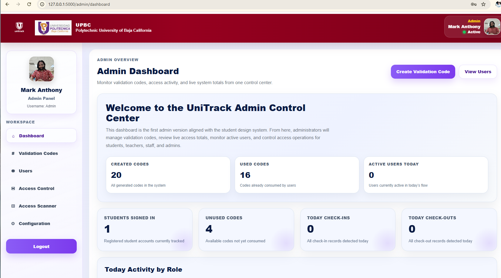

# 🎓 UniTrack


**UniTrack** is a university attendance and access control system designed to manage student, staff, and professor presence using QR-based check-in and check-out.

---

## 🌐 Live Demo

🔗 https://unitrack-6ozt.onrender.com

> Note: Render free tier may take a little time to wake up after inactivity.

---

## 🚀 Features

* 🔐 Role-based authentication (Admin, Student, Professor, Staff)
* 📱 QR Code access control (check-in / check-out)
* ⏱ Automatic time tracking and attendance logs
* 🧾 Validation code system for secure registration
* 👤 User management (admin panel)
* 🌐 Clean and responsive UI (mobile-friendly)
* 🔄 Real-time access status tracking

---

## 📸 Screenshots

### 🔐 Login



### 📊 Dashboard



### 🎫 Access Control



### 📱 QR Scanner



### 📜 Attendance History



### ⚙️ Configuration



### 🛠️ Admin Dashboard



---

## 🏗️ Tech Stack

* **Backend:** Python, Flask
* **Database:** SQLite (dev) / PostgreSQL (production ready)
* **ORM:** SQLAlchemy
* **Auth:** Flask-Login
* **Migrations:** Flask-Migrate (Alembic)
* **QR Generation:** qrcode
* **Frontend:** HTML, CSS, Jinja2

---

## 📁 Project Structure

```
unitrack/
│
├── app/
│   ├── models/
│   ├── routes/
│   ├── services/
│   ├── templates/
│   └── static/
│
├── migrations/
├── run.py
└── requirements.txt
```

---

## ⚙️ Installation

```bash
git clone https://github.com/Peyman-mxli/unitrack.git
cd unitrack
python -m venv venv
venv\Scripts\activate
pip install -r requirements.txt
```

---

## ▶️ Run the App

```bash
flask run
```

Or:

```bash
python run.py
```

---

## 🌐 Access

Local:

```
http://127.0.0.1:5000
```

Network:

```
http://<your-ip>:5000
```

---

## 🔑 Default Admin

> For a NEW database, Admin is created only when UNITRACK_INITIAL_ADMIN_PASSWORD is set to a unique password of at least 12 characters. Existing admin accounts are never overwritten.

---

## 📌 Roadmap

* [ ] Advanced attendance history
* [ ] Mobile app integration
* [ ] More admin features
* [ ] More teacher features
* [ ] Better design and structure

---

## 📄 License

This project is licensed under the MIT License.

---

## ⭐ Support

If you like this project, give it a ⭐ on GitHub!


---

👤 Author


Peyman Miyandashti
🎓 Polytechnic University of Baja California
💻 Information Technology Engineering & Digital Innovation
📍 From Mexico
📅 Year: 2026
🆔 ID: 250161


---


## 🔐 Operations and release safety

> UniTrack is under active development. Do not treat a successful local demo as certified physical access control.

### Local setup (Windows PowerShell)

```powershell
py -3.11 -m venv .venv
.\\.venv\\Scripts\\Activate.ps1
python -m pip install -r requirements.txt
python run.py
```

Existing `unitrack.db` files are not reset. For a brand-new database, set a unique administrator password **before the first launch**:

```powershell
$env:UNITRACK_INITIAL_ADMIN_PASSWORD = Read-Host 'Choose an initial admin password (12+ characters)'
python run.py
```

The first-run password is never stored in source code. The local Flask session key is randomly generated in `.unitrack-secret` (excluded from Git); keep this file private. Never post passwords, keys, tokens or database files to GitHub.

### Production settings

Configure environment variables through your hosting platform, not through committed files. See `.env.example` for variable names. Set `UNITRACK_ENV=production`, `UNITRACK_TIMEZONE=America/Tijuana`, a strong `SECRET_KEY`, `FLASK_DEBUG=False`, `APP_BASE_URL` to the HTTPS host, `DATABASE_URL` to a persistent PostgreSQL instance, and a newly generated `MAIL_PASSWORD` if email recovery is needed. Enforce HTTPS and secure cookies. This project is not ready for real-gate deployment until operator/scanner hardware and security have been tested on site.

**Security incident action:** historical Git commits contained an email application password. Immediately revoke that old app password in the email provider's security settings, generate a new one, and supply it only via your host's secret settings. Removing it from the current file does **not** erase repository history. Review previously committed profile photos before exposing the public repository; ignored files remain in Git history until separately remediated.

### Safely update an existing Windows installation

Open PowerShell **in the local UniTrack folder** (for example, `C:\\unitrack`). Stop the running Flask process with Ctrl+C before updating. This guarded updater is downloadable without first pulling Git changes:

```powershell
cd C:\unitrack
$updateScript = Join-Path $env:TEMP 'unitrack-safe-update.ps1'
Invoke-WebRequest -Uri 'https://raw.githubusercontent.com/Peyman-mxli/unitrack/main/scripts/safe_update.ps1' -OutFile $updateScript
powershell -NoProfile -ExecutionPolicy Bypass -File $updateScript
```

The script checks the Git origin and branch, refuses uncommitted tracked edits, verifies the existing `.venv`, makes and verifies an SQLite backup in ignored `backups/`, pulls with `--ff-only`, installs requirements, runs isolated tests, and starts the app only after success. It **never** deletes local database/photos, applies a stash, force-pulls, or re-creates a virtual environment. If any check fails, it exits and prints the reason. You can run it with `-SkipStart` to update and test without launching Flask.

**Important:** The script updates only the local Windows checkout. It cannot change the remote Render database, recover data lost from an ephemeral server disk, or rotate the email provider's exposed app password. For a hosted release, use a persistent external database, external upload storage and a new email application password. Ensure the Render service only deploys after GitHub CI checks pass.

### Safe database backup

```powershell
python scripts/backup_sqlite.py
```

This writes a timestamped, integrity-checked copy to `backups/` (ignored by Git), without replacing the live database. PostgreSQL production databases need managed database backups and restore drills. Never run `git stash pop` without reviewing the stashed files when local database changes are involved.

### Academics and QR access

- Professors and admins can manage classes at `/attendance/classes`: enroll students, schedule meetings, record Present/Late/Absent, and finalize attendance.
- Student academic attendance history displays scheduled **class** meetings, not campus gate access logs. Unmarked sessions are not counted absent until the teacher finalizes them.
- Role-approved scanners (admin, staff and professor) can read signed QR codes via the browser camera where `BarcodeDetector` and `getUserMedia` are supported; HTTPS or localhost is required for camera permission. Manual paste remains available for signed QR values.
- Generated QR codes expire after five minutes and can be consumed once. Attendance and access times use the campus timezone (`America/Tijuana` by default); change it through `UNITRACK_TIMEZONE` if the campus moves. Public mobile QR landing URLs only show instructions; they do not perform check-in or check-out. The old predictable access-code mode is disabled by default; `UNITRACK_ALLOW_LEGACY_QR=True` enables a temporary **admin-only** migration fallback and should not be enabled in production.
- Browser forms now use session CSRF tokens. Login and registration are rate-limited per IP. Staff/admin updates are auditable.

### Automated tests

```powershell
python -m unittest discover -s tests -v
```

GitHub Actions runs the isolated tests on `main` and pull requests. Still perform manual end-to-end tests for each role, database persistence, phone camera compatibility, email delivery, security permissions, and real campus network deployment before release.
